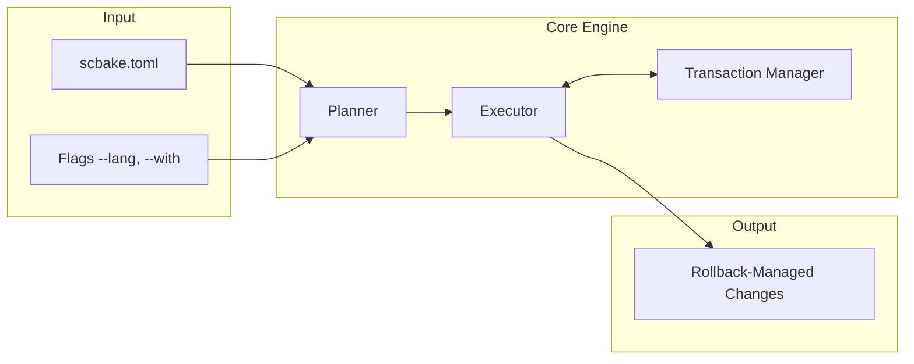

# Scaffold Bake: The Transactional Project Scaffolder

`scbake` is a single-binary CLI tool that simplifies project setup and maintenance by applying layered infrastructure templates and language packs with rollback on handled failures. It uses a **manifest file (`scbake.toml`)** as the source of truth for configuration, ensuring consistent configuration across projects. The scbake binary is self-contained; language packs may invoke the external toolchains listed below.


## Core Philosophy: Layering, Safety, and Extensibility

`scbake` provides a safe, composable, and customizable way to manage project infrastructure.



- **Layered Composition**
  Projects are built by applying independent **layers** (language packs and tooling templates). You can **mix and match** templates to achieve the desired setup.

- **Highly Configurable & Extensible**  
  Designed for flexibility. If a language pack is missing, simply **add it**. If a template doesn't fit, you can **modify or replace it**. The handler interface simplifies extension.

- **Built-in Rollback Safety**
  File and directory writes performed by scbake's file tasks are managed by a
  transaction manager. A created regular file is removed only when a content
  hash recorded by the transaction still matches its raw bytes; file-task writes
  record that hash before writing, while declared command outputs, archive
  destinations, and the manifest are recorded after their write. Created
  directories are removed deepest-first and only when empty. Files those tasks
  overwrite are restored from on-disk backups when a task or the manifest save
  fails. External tool commands are opaque, so handlers declare the paths a
  command may create or modify. Those paths are tracked before the command runs:
  missing regular files are snapshotted after the command and removed only when
  their content still matches, and existing regular files are backed up with
  their content and mode. Tracking an existing directory does not snapshot its
  contents. Zip extraction commands can also declare an archive whose entries
  are validated and tracked individually before extraction, including nested
  destinations and missing ancestors. Rollback covers project files, declared
  manifests, and declared zip entries, not build state. Pre-existing dependency
  trees such as `node_modules`, `.git` internals, non-zip extraction, and writes
  outside declared paths remain outside the transaction; custom handlers must
  declare their own paths. Repeated opaque writers and legacy journals can
  leave conservative residue: unverifiable regular files are kept rather than
  deleted. If a dependency install fails, delete the affected tree (for example
  `node_modules`) and reinstall from `package.json`/`package-lock.json`; the
  manifests are restored by rollback. SIGINT and SIGTERM cancel running tasks,
  stop the child process, run the same rollback as an in-process error, and exit
  130/143. SIGKILL and other abrupt process termination bypass deferred cleanup,
  but the next run reports the interrupted transaction instead of treating it as
  clean; `scbake recover` rolls it back from the on-disk journal.

- **Prioritized Execution**  
  Tasks run in a defined order using **Priority Bands** (e.g., directory creation → language setup → universal config) to ensure dependencies are met.

- **Governance File Templates**
  Generates common governance files: a license, code owners, security policy,
  and community documents.

- **Custom Template Overrides (BYOT)**  
  Override any embedded `.tpl` file with your own version by passing `--template-dir` or setting the `SCBAKE_TEMPLATE_DIR` environment variable. Files in the override directory shadow the compiled-in defaults, enabling team-specific customizations without recompiling. The override directory is resolved and must exist before `new`, `apply`, `update`, or `drift --repair` starts, so a stale `SCBAKE_TEMPLATE_DIR` now fails those commands instead of silently falling back to the built-in templates.

- **Private Template Registries**  
  Define named remote registries to host and distribute team templates. Use `scbake template registry add` to register a source, then `scbake template pull` to cache templates locally. The resolution chain checks **local overrides → configured registry cache → embedded defaults**, so you can layer customizations at every level. Only registries listed in `registries.json` participate: a cached template whose registry is not configured is never read, and removing a registry deletes its cached templates (a failed delete leaves inert `.evict-*` residue that is retried later). Registries can override files of built-in templates and language packs, but they cannot add new template or language names.

- **Template Schema & Input Validation**  
  Every template can declare its expected inputs in a `schema.json` embedded alongside its templates. Before a single task executes, scbake validates the manifest metadata and `--set` flags against all selected templates' schemas, catching missing required variables early.

- **Explicit & Non-Interactive**  
  No hidden prompts. Output is deterministic for fixed inputs and a fixed clock,
  except where a task fetches external content: `npm create vite@latest`,
  `go mod tidy`, and `start.spring.io` inherit upstream-version and network
  behavior. The `compliance` license text is rendered from the embedded SPDX
  snapshot, so only its copyright year follows the local clock.


## Installation

### Quick Install (macOS, Linux, and Windows via WSL/Git Bash)

Install from a **pinned release tag**. Unlike a branch URL, a release tag is
immutable, and the installer is attached to the release alongside its checksum.

`install.sh` is published as a release asset starting with the first release
that includes this installer change; older tags predate it and do not have the
asset (their `install.sh` URL 404s). Use the **latest** tag from
<https://github.com/Emin-ACIKGOZ/scbake/releases/latest>:

```bash
( set -e
# Set TAG to a release that ships install.sh. Use the latest release tag
# (see https://github.com/Emin-ACIKGOZ/scbake/releases/latest) — older tags
# do not contain the installer asset.
TAG=<tag>
BASE="https://github.com/Emin-ACIKGOZ/scbake/releases/download/${TAG}"

# Download the installer and verify it against the release checksums
# (on macOS, use: shasum -a 256 -c -)
curl -fsSL -o install.sh "${BASE}/install.sh"
curl -fsSL -o SHA256SUMS "${BASE}/SHA256SUMS"
grep 'install.sh$' SHA256SUMS | sha256sum -c -

# Run the installer, pinned to the same tag
bash install.sh "${TAG}"
)
```

The installer detects your OS/architecture and installs that release's binary to
your PATH. It downloads the release's `SHA256SUMS` and verifies the binary
against it, aborting if the checksums file is missing or the hash does not match.

> **Do not** pipe a branch URL such as
> `https://raw.githubusercontent.com/Emin-ACIKGOZ/scbake/master/install.sh`
> into `bash`: `master` is mutable, so the script can change between review and
> execution. Download a pinned release (and verify it) instead.

**See [INSTALLING.md](docs/INSTALLING.md)** for detailed instructions, troubleshooting, and alternative installation methods:
- Go Install
- Manual download from GitHub Releases
- Build from source

### Build from Source

To compile the binary yourself, ensure you have **Go 1.26+** installed:

#### 1. Clone the repository:
```bash
git clone https://github.com/Emin-ACIKGOZ/scbake.git
cd scbake
```

#### 2. Build the project:
```bash
go build -o scbake main.go
```

#### 3. Move the binary to your path (optional):
```bash
mv scbake /usr/local/bin/
```

## Commands & Usage

### `new`: Create a New Project

Creates a new directory, bootstraps the `scbake.toml` manifest, and applies language packs and templates. 

**Note:** Git initialization can be added via the `--with git` template. When the template will run, Git must be installed and able to resolve both the author and committer identity (`user.name`/`user.email`, or **both** the `GIT_AUTHOR_*` and `GIT_COMMITTER_*` environment pairs; either pair alone is not enough). When the template will run, a missing identity fails before anything is written, including in a dry run. The template is skipped with a notice when the target already contains `.git` (even a broken or dangling entry), when a `.git` entry exists in the target's nearest existing ancestor chain (the filesystem boundary root discovery uses), or when Git reports it inside a work tree; a skipped target needs no identity and exits 0. The ancestor check still applies when Git refuses to inspect the repository, for example with `GIT_CEILING_DIRECTORIES`, an empty or corrupt `.git`, or dubious ownership. `GIT_DIR` alone can make an unrelated target look like a work tree and cause a skip, but `GIT_DIR` together with `GIT_WORK_TREE` naming another repository is not detected: the target is not skipped and the template's Git commands commit into that other repository. Unset `GIT_DIR` and `GIT_WORK_TREE` (or run without them) whenever you use `--with git`. A bare repository has no `.git` entry and is not detected. At detectable boundaries, `scbake` does not create a nested repository.

```bash
scbake new <project-name> [--lang <lang>] [--with <template...>] [--license <spdx>] [--copyright-holder <name>] [--template-dir <dir>] [--conflict-strategy <strategy>]
```

| Flag                 | Description                                      | Example                     |
| :------------------- | :----------------------------------------------- | :-------------------------- |
| `--lang`             | Primary language pack (`go`, `svelte`, `spring`) | `--lang go`                 |
| `--with`             | Comma-separated tooling templates                | `--with makefile,ci_github` |
| `--license`          | SPDX License ID (required for `compliance`; embedded, works offline) | `--license MIT`             |
| `--copyright-holder` | Copyright holder name (required for `compliance`) | `--copyright-holder "Acme Corp"` |
| `--template-dir`     | Directory with custom template overrides         | `--template-dir ./my-tpls`  |
| `--set`              | Set template variable (`key=value`, can be repeated) | `--lang go --set module_path=github.com/acme/app` |
| `--conflict-strategy`| How to resolve file drift: `merge`, `fail`, `overwrite`, `artifact`, `keep-local` | `--conflict-strategy overwrite` |

**Example:**

```bash
scbake new my-backend --lang go --with makefile,ci_github
```


### `apply`: Apply Templates to an Existing Project

Applies new language packs or tooling templates to an existing path. Because `scbake` uses its own transaction logic, it does **not** require a clean Git tree to start; rollback and opaque-command caveats still apply. `apply`, `update`, and `drift --repair` require an existing project root and fail instead of creating a missing target directory; use `new` to bootstrap a new project.

```bash
scbake apply [--lang <lang>] [--with <template...>] [--template-dir <dir>] [--conflict-strategy <strategy>] [<path>]
```

| Argument | Description      | Default |
| :------- | :--------------- | :------ |
| `<path>` | Target directory | `.`     |

**Example:**

```bash
scbake apply --with maven_linter
```


### `update`: Update a Generated Project

Re-applies the managed template file writes recorded in `scbake.toml`, bringing a
generated project up to date **without clobbering local edits**. It does not
replay side-effecting commands or tasks whose writes are not tracked in the
`managed_files` ledger, such as file appends or XML insertions. Recorded managed
writers, including the compliance LICENSE generator, are replayed. A LICENSE
that already matches its recorded hash is left untouched, so a clean update
needs no network and does not re-stamp the copyright year. When LICENSE is
missing or modified, the text is rendered from the embedded SPDX snapshot; no
network access is needed. An unknown license ID is the fail-closed case, and
`update` then leaves the managed files untouched. To change license terms, run
`apply --with compliance` (or delete LICENSE before `update`).

```bash
scbake update [--template-dir <dir>] [--conflict-strategy <strategy>] [<path>]
```

| Argument | Description      | Default |
| :------- | :--------------- | :------ |
| `<path>` | Target directory | `.`     |

Unlike `apply`, `update` reads *what was applied* from the manifest and runs no
side-effecting commands (no `go mod init`, `npm install`, …), so it is safe to
run repeatedly:

- **Idempotent.** With no template change and no drift, it makes no writes.
- **Three-way merge.** A pristine copy of each managed file is kept under
  `.scbake-base/`; when both the template and your file changed, `update` merges
  non-overlapping edits. Overlapping edits are written to a `<file>.scbake-new`
  artifact instead of being applied.
- **Policy.** `--conflict-strategy` accepts `merge` (default), `fail`,
  `overwrite`, `artifact`, and `keep-local`.

**Exit contract:**

`update` exits 0 when it completes, including when blocking drift remains because
`--conflict-strategy merge` preserved local edits. Exit 0 therefore means “the
command ran”, not “the tree is clean”.

| Outcome | Exit |
| :------ | :--- |
| No changes needed, or the tree is clean after the update | 0 |
| Completed with residual drift (for example, merge preserved local edits) | 0 |
| Load, plan, write, or commit failure | non-zero |

Run `scbake drift` as the gate: it exits 1 while blocking drift remains. For an
intentional local edit, record a new baseline with
[`scbake accept`](#accept-rebaseline-a-managed-file); then `drift` is clean
without discarding the edit.

**Example:**

```bash
cd my-backend
scbake update
scbake drift   # the authoritative clean/dirty gate
```

`scbake.toml` may also record two additive fields. `[accepted_files]` stores a
user-accepted working-tree baseline per managed key, while `[managed_files]`
keeps the pristine template hash; `unmanaged_files` lists paths detached from
scbake. `update` and `drift --repair` never re-manage a detached path, and an
accepted file is a no-op only while both its working bytes and the template
render are unchanged; an `update --force` or `--conflict-strategy overwrite`
still rewrites it and clears the acceptance. Use the `accept` and `unmanage`
commands rather than editing these fields by hand.

#### Committed merge base and migration

`.scbake-base/` is committed with the project, so a fresh clone has the common
ancestor that `update` needs. The root `.gitignore` keeps private state ignored
and re-includes the committed base:

```gitignore
.scbake/
!.scbake-base/
!.scbake-base/**
!.gitignore
```

Keep this block at the end of `.gitignore`: a later pattern such as `*`
overrides the re-includes and can hide the base. Scbake appends missing lines but
does not move an existing block, so check the order after editing `.gitignore`.

Run `git add .` from the manifest root, not a subdirectory, so new base files
are staged. Inside `.scbake-base`, a managed `.gitignore` or `.gitattributes` is
stored as `.gitignore.scbake-shadow` or `.gitattributes.scbake-shadow` so Git
does not apply those rules to the base tree itself. Those two suffixed names are
reserved.

The base stores pristine rendered bytes, so it can duplicate ignored build
outputs and any secret a template rendered. It also adds repository churn
whenever generated content changes; review the committed tree before publishing.

`managed_files` hashes are EOL-insensitive for NUL-free content: every run of CR
bytes immediately before LF is folded to one LF before hashing, so CRLF and LF
hash the same. This also means NUL-free binary content containing CRLF is
treated as text for hashing, and EOL-only edits are not drift. NUL-bearing
content is hashed byte-exact. A legacy file recorded while rendered as CRLF can
report one-time drift after upgrading. Base validation accepts a base whose
normalized or raw hash matches the ledger, but a legacy CRLF ledger hash does not
survive Git normalizing the migrated base to LF. Refresh the ledger with a clean
`scbake update` (or otherwise re-record the normalized hash) before committing
the migrated base, or keep the base byte-exact with `-text`.

**Breaking change.** This release no longer reads the old `.scbake/base/` path.
Migrate once by copying the base, renaming the two Git-special files, and
committing the result:

```sh
mkdir -p .scbake-base
cp -a .scbake/base/. .scbake-base/
find .scbake-base -type f -name .gitignore \
  -exec sh -c 'mv -n "$1" "$1.scbake-shadow"' _ {} \;
find .scbake-base -type f -name .gitattributes \
  -exec sh -c 'mv -n "$1" "$1.scbake-shadow"' _ {} \;
# Ensure the ignore block above is present at the end of .gitignore.
git rm -r --cached .scbake/base 2>/dev/null || true
git add .gitignore .scbake-base
git commit -m 'chore: migrate scbake merge base to .scbake-base'
rm -rf .scbake/base
```

If the legacy ledger holds raw CRLF hashes and Git normalizes the migrated base
to LF, those hashes no longer match: run a clean `scbake update` to refresh the
ledger before committing, or keep the base byte-exact with `-text`.

`git mv .scbake/base .scbake-base` alone is insufficient: the copied
`.gitignore` and `.gitattributes` would keep names Git applies to the base tree.
A missing or invalid base fails closed to a `.scbake-new` artifact, but sparse or
partial clones that omit `.scbake-base/` cannot merge. Native Windows/macOS
filters, LFS, and `working-tree-encoding` transformations remain unverified;
plain CRLF is handled by hash and merge-input normalization.

`drift` reports a base that is absent as `base-missing` (advisory by default)
and a base whose normalized or raw hash no longer matches the ledger as
`base-invalid` (blocking). Pass `--require-base` to make a missing base block,
for example in CI that requires a complete committed base. Detection is
read-only and lock-free and never backfills the base: a no-op `update` also does
not backfill. On a clean tree,
`scbake drift --repair --conflict-strategy overwrite` re-records the base as
part of rewriting the file; preserve local edits first, because that strategy
overwrites them and the default `merge` repair does not backfill.


### `drift`: Detect (and Repair) Changes to Managed Files

Reports whether the files scbake generated still match the hashes recorded in
`scbake.toml`, without writing anything. It exits non-zero when blocking drift
is found, so it can gate a CI pipeline.

```bash
scbake drift [--repair] [--require-base] [--conflict-strategy <strategy>] [<path>]
```

| Argument | Description      | Default |
| :------- | :--------------- | :------ |
| `<path>` | Target directory | `.`     |

- **Detection is read-only.** No templates are rendered, no transaction is
  opened, no lock is taken, and the network is never touched. Detection always
  scans every managed file recorded in the manifest, not just the `<path>`
  project.
- **Modified vs. missing.** Each managed file is reported as `modified` (its
  normalized hash changed) or `missing` (deleted), with its recorded and
  on-disk hashes. Hashes are EOL-insensitive for NUL-free content, so an
  EOL-only change is not drift.
- **Accepted baselines.** A key with an `[accepted_files]` entry is compared
  against that accepted hash and reported with `accepted <hash>` instead of
  `recorded <hash>`. The committed base is still validated against the pristine
  `[managed_files]` hash.
- **Committed base.** For every current key, the pristine base under
  `.scbake-base/` is compared with the recorded hash. An absent base is
  `base-missing`; a base whose normalized or raw hash no longer matches is
  `base-invalid`, with the expected base path and both hashes. Keys resolved
  only through a legacy project path are skipped because no version wrote a
  base for a flat pre-scoping key. An unreadable base (other than "not found")
  is an error, not a finding.
- **Repair** (`--repair`) reuses the same reconciliation as `update`, so local
  edits are preserved according to `--conflict-strategy` (`merge` by default).
  Because `merge` preserves local edits, it does not clear drift; use
  `--conflict-strategy overwrite` to force generated content back. Under
  `overwrite`, a clean tree also re-records a missing base for non-LICENSE
  managed files; a clean LICENSE is backfilled on any strategy. Repairing a
  missing or modified compliance LICENSE renders the text from the embedded SPDX
  snapshot, so that case needs no network access; a clean LICENSE is backfilled
  from its recorded bytes without re-rendering. An unknown license ID is the
  fail-closed case: repair stops and leaves the files untouched.

Exit behavior:

| Finding | Default | `--require-base` |
| :------ | :------ | :--------------- |
| `modified`, `missing`, `base-invalid` | exit 1 | exit 1 |
| `base-missing` only | exit 0 (advisory) | exit 1 |

`--require-base` promotes missing bases to blocking results and cannot be
combined with `--repair`. A concurrent `update` can momentarily expose a
partially written base, so detection remains lock-free and may report a
transient `base-invalid` rather than taking the project lock.

`--repair` follows the same completion contract as `update`:

| `--repair` outcome | Exit |
| :----------------- | :--- |
| Completed, including residual drift that it reports | 0 |
| Repair failed (load, render, write, or re-check) | non-zero |

It exits 0 after reports such as
`Repair finished; N managed file(s) still drifted`, because `merge`
deliberately preserves local edits. The repair did run; the tree is not
necessarily clean. Use `drift` to gate, `--conflict-strategy overwrite` to
force generated content back, or
[`accept`](#accept-rebaseline-a-managed-file) to keep an intentional edit as the
new baseline.

**Example:**

```bash
# Fail a CI job if generated infrastructure was edited or deleted.
scbake drift

# Also fail when a committed merge base is missing.
scbake drift --require-base

# Force generated content back (discarding local edits).
scbake drift --repair --conflict-strategy overwrite

# Re-apply template changes, keeping non-overlapping local edits.
scbake drift --repair --conflict-strategy merge
```


### `accept`: Rebaseline a Managed File

Records the current working-tree bytes of one or more managed files as their
**accepted** drift baseline. The file itself is not rewritten, and the pristine
`[managed_files]` hash and the committed base under `.scbake-base/` are left
untouched. `drift` compares the working tree against the accepted hash, while
base validation still uses the pristine hash.

```bash
scbake accept <path>...
```

- **One-shot rebaseline.** A later edit drifts again. Accept is not "stop
  tracking"; use `unmanage` for that.
- **Managed only.** Each path must already be a `[managed_files]` key. Accept
  never adopts an untracked file, a directory, or a symlinked leaf.
- **Base preflight.** An existing committed base must still match the pristine
  ledger hash; an invalid base fails so accept cannot claim success while
  `drift` remains red. A missing base only warns, because missing bases are
  advisory unless you pass `drift --require-base`.
- **Template changes.** If a template render changes, `update` merges or writes
  against the pristine base and a canonical write clears the accepted entry;
  review the result and accept again if needed.
- **Root `.gitignore` caveat.** Accepting the root `.gitignore` while it is
  missing scbake's internal-state block records the block-less bytes as the
  baseline, and the accepted no-op suppresses regeneration. Later `apply` and
  `update` then leave `.scbake/` unignored and may not re-include
  `!.scbake-base/`, breaking the committed-base guarantee; `git status` can show
  `.scbake/` as untracked. Plain `scbake apply` fails because it needs a
  language or template, `scbake apply --lang <lang>` only warns, and
  `scbake update` exits 0 silently with the block still absent. Repair it first
  with `scbake apply --force --lang <lang>` or
  `scbake apply --conflict-strategy overwrite --lang <lang>`, or with
  `scbake update --conflict-strategy overwrite`; a manual edit also works.
  Only the language pack, or a custom template that renders the root
  `.gitignore`, can repair it: no shipped `--with` tooling template renders
  that file, so e.g. `--with makefile` leaves it block-less. Then accept.
- **Atomic and dry-run safe.** All paths are validated before any change, and
  `--dry-run` validates and prints without writing or taking the project lock.

```bash
# Keep an intentional edit and make the drift gate clean.
scbake accept main.go

# Preview without writing.
scbake accept --dry-run main.go
```


### `unmanage`: Detach a Managed File

Detaches one or more managed files from scbake. The path is removed from
`[managed_files]` and `[accepted_files]`, recorded in `unmanaged_files`, and its
committed base is removed transactionally. The working file is left exactly as
it is.

```bash
scbake unmanage <path>...
```

- **No drift, no updates.** `drift` ignores a detached path, and `update` or
  `drift --repair` will not rewrite, recreate, or re-record it.
- **Apply needs `--force`.** `apply` skips unmanaged paths by default. Running
  `scbake apply --force --lang <lang>` (or `--with <template>`) re-manages one,
  writes canonical content, and clears the unmanaged entry.
- **Root `.gitignore` is refused.** Scbake maintains its internal-state ignore
  block in the root `.gitignore`; use `accept` or edit that block manually. A
  nested `.gitignore` can be unmanaged.
- **Missing files are allowed.** The state is what is detached, so a deleted
  working file is not recreated. Repeated `unmanage` is idempotent.
- **Atomic and dry-run safe.** Base removal and the manifest save share one
  transaction; `--dry-run` writes nothing and takes no lock.

```bash
# Take ownership of a generated starter file.
scbake unmanage main.go

# Preview the base removal and manifest change.
scbake unmanage --dry-run main.go
```

> **Downgrade warning.** `[accepted_files]` and `unmanaged_files` are additive
> and do not change the schema version. An older scbake binary ignores unknown
> fields and may drop them on save. It will report accepted edits as drift,
> recreate and re-record a missing detached path, and write an existing detached
> file to a `.scbake-new` artifact instead of re-managing it. Commit before
> running an older binary on a project that uses these fields.


### `recover`: Roll Back an Interrupted Transaction

A crash or `SIGKILL` can leave a transaction journal under
`.scbake/tmp/`. The next `apply`, `update`, `accept`, `unmanage`,
`drift --repair`, or `drift` refuses to treat that tree as clean. Roll the
interrupted run back with:

```bash
scbake recover [--discard] [<path>]
```

| Argument    | Description                                      | Default |
| :---------- | :----------------------------------------------- | :------ |
| `<path>`    | Project directory inside the manifest root       | `.`     |
| `--discard` | Delete the transaction without restoring backups | `false` |

Recovery refuses to touch a transaction whose process is still running. Use
`--discard` only when the backups are known to be unusable; it deletes the
transaction directory without restoring files. An interrupted `new` is removed
as a whole after a successful recovery, matching the command's handled-error
cleanup.


### Concurrent Runs and Exit 75

Mutating commands (`new`, `apply`, `update`, `accept`, `unmanage`,
`drift --repair`, `recover`, and `recover --discard`) take a non-blocking
exclusive advisory lock on `<root>/.scbake/lock` before loading the manifest and
hold it through commit or rollback. The lock is scoped to the manifest root, so
parallel subproject runs under one root serialize on the same file. If another scbake process already
holds the lock, the command fails fast with exit **75** (`EX_TEMPFAIL`) and
makes no project changes; retry after the active run finishes. One exception:
`apply --with git` runs its read-only Git preflight before acquiring the lock,
so a missing Git identity exits **1** even when the lock is busy; with a usable
identity, a busy lock still exits **75**. `new` runs the same preflight and then
creates the project directory and an empty manifest before locking: a missing
identity exits **1** before the directory exists, while a busy failure can leave
that bootstrap residue for you to retry or remove.

Read-only commands (`drift`, `list`, and template registry/cache commands) and
every `--dry-run` run do not take the lock, so they remain usable while a writer
is active. `drift` and `apply --dry-run` still refuse a tree with an interrupted
transaction journal; `list` and template commands do not read project
transaction state.

The kernel releases the lock when the process exits, including a crash or
`SIGKILL`; a leftover `.scbake/lock` file is harmless because the lock is kernel
state, not file existence. Normal release removes the file and prunes an empty
`.scbake` directory. The manifest modification-time check is retained as a
fallback for non-scbake writers; the root lock is the primary scbake-vs-scbake
concurrency guard.

Rollback verifies created paths before removing them. A created regular file is
deleted only when a content hash recorded by the transaction still matches the
file's current raw bytes. File-task writes record that hash before writing;
declared command outputs, archive extraction destinations, and a newly saved
manifest are snapshotted after their write, so a file created once by an opaque
writer remains removable. A created directory is removed deepest-first, and only
when it is empty. Created regular files with no recorded hash, such as entries
from a legacy journal, an interrupted write, or undeclared opaque output, are
kept with a warning instead of being deleted. Non-empty directories are kept,
and repeated opaque writers can make the recorded hash stale, leaving
conservative residue rather than deleting unverified content.


### `template registry`: Manage Remote Registries

Define and manage remote template registries for sharing templates across teams.

```bash
scbake template registry add <name> <url> [--token <token>] [--version <version>] [--subdirectory <dir>]
scbake template registry remove <name>
scbake template registry list
```

| Command | Description |
| :------ | :---------- |
| `add <name> <url>` | Register a new template registry with optional auth token, default version, and archive subdirectory |
| `remove <name>` | Remove a registered registry; delete its cached templates best-effort (leftover residue is retried) |
| `list` | List all configured registries |

#### `template pull`: Cache Templates Locally

Downloads a template archive from a registry to the local cache (`~/.cache/scbake/templates/`), making its files available as an override for `scbake new/apply`.

```bash
scbake template pull <name> [--registry <name>]
```

Only built-in tooling template and language-pack names can be pulled (see `scbake list templates` and `scbake list langs`). A registry overrides files belonging to those names; it cannot add new template or language names. Pulls only take effect for handlers that read template files: the `git`, `svelte`, and `spring` handlers currently scaffold without overridable templates.

If `--registry` is omitted, all configured registries are tried in order.

Only configured registries participate in resolution: a cache entry whose
registry is absent from `registries.json` is never read. `template registry
remove` deletes that registry's cached templates along with the config entry, so
removal means removal. The config change is saved before the cached tree is
deleted; if that deletion fails, the command warns and still exits successfully,
and the next `registry add` or `registry remove` (or the internal `SetToken`
API) reclaims the leftover tree once it is older than 60 seconds, provided the
staged residue is deletable; if the cleanup failed because the residue's
directories are read-only, fix their permissions (for example `chmod 755` them)
so a later sweep can reclaim it.
An interrupted removal is recovered the same way: the staged tree is restored
when the registry is still configured from the same source, and discarded
otherwise. Residue left by older versions under `.evict-<digits>` names cannot be
attributed and is never removed automatically; delete it by hand while no
registry command is running. Because resolution is config-derived, deleting
`registries.json` or removing (or renaming) a registry entry disables that cache
instead of letting stale content shadow an embedded template; a malformed or
unreadable config disables the registry tier. Changing only a registry's URL,
version, or token does not evict or invalidate existing cached content: it keeps
resolving until `template pull` refreshes it or `registry remove` deletes it.
Re-run `template registry add` and `template pull` to restore an override.

`--dry-run` names the tier that supplies each template-rendered file: `[template-dir]`,
`[registry: <name>]`, or `[built-in]`. For example:

```
[DRY RUN] Create standardized .editorconfig [registry: team]
```

Archives with a single top-level directory named exactly like the template and
at least one file directly inside it (for example `makefile/makefile.tpl` for
`makefile`) are unwrapped automatically. Any other shape, including files nested
under `templates/`, needs `--subdirectory <dir>` on `template registry add` so
the archive is cached at the expected layout.

### `list`: View Available Resources

Lists available or applied resources.

```bash
scbake list [langs|templates|projects]
```

### Monorepo Management

`scbake` is natively monorepo-aware. It walks up from the target path to find the nearest `scbake.toml` or `.git` folder, allowing you to manage a fleet of projects from a single central manifest.

Discovery is bounded by the nearest Git root: a manifest at or below that root wins, and a manifest above it is ignored. When the target tree has no `scbake.toml` and no `.git` bounds it (for example a directory under `/tmp` or a shared parent), a stray ancestor manifest is **not** adopted; discovery falls back to the target directory. This prevents a stray ancestor manifest in a shared parent from supplying project state, though it is not a security boundary against a principal that can also plant `.git` (see the caveat below).

- **Central Manifest**: Initialize your monorepo root with `scbake new <root-name> --with git` (or run `git init` in the root). This gives discovery an unambiguous repository boundary.
- **Add Projects**: Run `scbake apply <path> --lang <lang>` to add a new project in a subdirectory. `scbake` will find the root manifest and add the project to the central tracking list.
- **Scoped Templates**: Apply templates to specific sub-directories by passing the path: `scbake apply services/api --with go_linter`.
- **No Nested Repositories at Detected Boundaries**: `--with git` is skipped with a notice when the target already has a `.git` entry, when a `.git` marker exists in its nearest existing ancestors (even if Git cannot inspect that repository), or when Git reports it inside a work tree. The root `.git` remains the discovery boundary; a bare repository has no `.git` marker and is not detected, and an existing nested `.git` from an older version is not removed automatically.
- **Fleet-wide Governance**: Run `scbake apply --with makefile` at the root to generate a unified build system that orchestrates all sub-projects.
- **Non-Git Monorepos**: If the central manifest lives in a tree without a Git root, pass `--allow-ancestor-search` to `apply`, `update`, `drift`, `list`, `accept`, `unmanage`, or `recover` so an ancestor manifest can be adopted. The flag never crosses a `.git` root. It is not a security boundary: a principal that can write an ancestor directory can also plant a `.git` marker there.

**Note:** `--allow-ancestor-search` is an explicit opt-in for non-Git monorepos. Without it, applying to a marker-less subproject creates a nested manifest in that subproject instead of updating the central one. `update`, `drift`, `list`, `accept`, `unmanage`, and `recover` also need the flag in a non-Git monorepo; without it, `drift` finds no local manifest and fails instead of evaluating the central one.


## Supported Language Packs

| Language   | Initialization Tasks                                                            | Required Binaries       |
| :--------- | :------------------------------------------------------------------------------ | :---------------------- |
| **Go**     | Creates `.gitignore`, `main.go`; runs `go mod init`, `go mod tidy`              | `go`                    |
| **Svelte** | Runs `npm create vite@latest`, installs dependencies, sets NPM scripts          | `npm`                   |
| **Spring** | Downloads starter zip from `start.spring.io`, extracts, makes `mvnw` executable | `curl`, `unzip` |

**Note:** Spring scaffolding only requires `curl` and `unzip`. Java is required later to build the generated project, not to create it.


## Tooling Templates

| Template        | Priority Band           | Features                                       |
| :-------------- | :---------------------- | :--------------------------------------------- |
| `community`     | Universal Config (1000) | Scaffolds `CONTRIBUTING.md`, `CODE_OF_CONDUCT.md`, `SUPPORT.md`, and `GOVERNANCE.md` |
| `editorconfig`  | Universal Config (1000) | Standard file formatting across the project                       |
| `ci_github`     | CI (1100)               | Conditional CI setup based on detected languages          |
| `compliance`    | Linter (1200)           | Adds `SECURITY.md`, `dependabot.yml`, `CODEOWNERS`, and a `LICENSE` built from embedded SPDX data |
| `go_linter`     | Linter (1200)           | Standard `golangci-lint` configuration                     |
| `maven_linter`  | Linter (1200)           | Checkstyle config + automatic pom.xml plugin integration                       |
| `svelte_linter` | Linter (1200)           | ESLint 9 integration for Svelte projects          |
| `makefile`      | Build System (1400)     | Universal build/lint scripts for all projects  |
| `devcontainer`  | Dev Env (1500)          | Containerized DX with auto-detected toolchains |
| `git`  | Version Control (2000)          | Initializes repo, stages all files, and creates initial commit. Skipped with a notice inside an existing work tree, below an ancestor `.git` marker, or when `.git` already exists; when it actually initializes, requires a resolvable Git identity |

The `compliance` template resolves `--license` from an SPDX License List
snapshot embedded in the binary, so license generation works offline. See
[`pkg/templates/compliance/internal/spdx/README.md`](pkg/templates/compliance/internal/spdx/README.md)
for the pinned version and maintainer refresh instructions.

## Extending `scbake`

### Creating Custom Handlers

1. Create a new package under `pkg/lang` or `pkg/templates`.
2. Implement the `Handler` interface using task types.
3. Register the handler in the relevant `registry.go`.

### Available Task Types

- **CreateTemplateTask**: Creates new files from templates using a 3-tier resolution chain: **local overrides** (`--template-dir`) → **registry cache** (configured registries only) → **embedded defaults** (compiled-in)
- **AppendFileTask**: Appends content to existing files with idempotency checks
- **ExecCommandTask**: Executes shell commands with optional output tracking
- **CreateDirTask**: Creates directories with transaction tracking
- **InsertXMLTask**: Modifies existing XML files by inserting fragments at specified paths
- **ScaffoldTask**: Runs a project generator in an empty staging leaf and moves its output into the target, with a sentinel check and fail-closed collision preflight

### Example: Modifying Existing XML Files

For handlers that need to modify existing XML files (like Maven pom.xml), use `InsertXMLTask`:

```go
// Read snippet from embedded template
snippet, _ := templates.ReadFile("plugin_snippet.xml.tpl")

// Create insert task
task := &tasks.InsertXMLTask{
    FilePath:    "pom.xml",
    ElementPath: "/project/build/plugins",
    XMLContent:  string(snippet),
    Desc:        "Inject plugin into pom.xml",
    TaskPrio:    1201,
}

// The task automatically:
// - Validates XML structure
// - Prevents duplicate insertions (idempotent)
// - Integrates with transaction manager for rollback
// - Validates paths to prevent directory traversal
```


## Development Details

### Task Execution Priority

| Band Name             | Range     | Purpose               |
| :-------------------- | :-------- | :-------------------- |
| `PrioDirCreate`       | 50–99     | Directory creation    |
| `PrioLangSetup`       | 100–999   | Language setup        |
| `PrioConfigUniversal` | 1000–1099 | Universal config      |
| `PrioCI`              | 1100–1199 | CI workflows          |
| `PrioLinter`          | 1200–1399 | Linter setup          |
| `PrioBuildSystem`     | 1400–1499 | Build systems         |
| `PrioDevEnv`          | 1500-1999     | Dev environment setup |
| `PrioVersionControl`          | 2000-2100     | VCS initialization (Git) |

### Global Flags

| Flag                  | Description                                          |
| :-------------------- | :--------------------------------------------------- |
| `--dry-run`           | Show planned changes without applying them            |
| `--force`             | Override safety checks                               |
| `--template-dir`      | Directory with custom template overrides (env: `SCBAKE_TEMPLATE_DIR`) |
| `--allow-ancestor-search` | Allow ancestor `scbake.toml` discovery when no Git root bounds the tree |
| `--conflict-strategy` | How to resolve file drift: `merge`, `fail`, `overwrite`, `artifact`, `keep-local` |
| `-v`, `--version`     | Show version                                          |
| `--set`              | Set template variable (`key=value`, can be repeated)  |

## Contributing

Contributions are welcome. See [CONTRIBUTING.md](CONTRIBUTING.md) for guidelines,
[docs/SCOPE.md](docs/SCOPE.md) for what belongs in core,
[docs/COMMIT_MESSAGES.md](docs/COMMIT_MESSAGES.md) for commit conventions,
[docs/CI_ARTIFACTS.md](docs/CI_ARTIFACTS.md) for verifying CI artifacts, and
[docs/TRIAGE.md](docs/TRIAGE.md) for how issues are handled.

## License

scbake is licensed under the Apache License 2.0. See [LICENSE](LICENSE) and
[NOTICE](NOTICE) for details.
