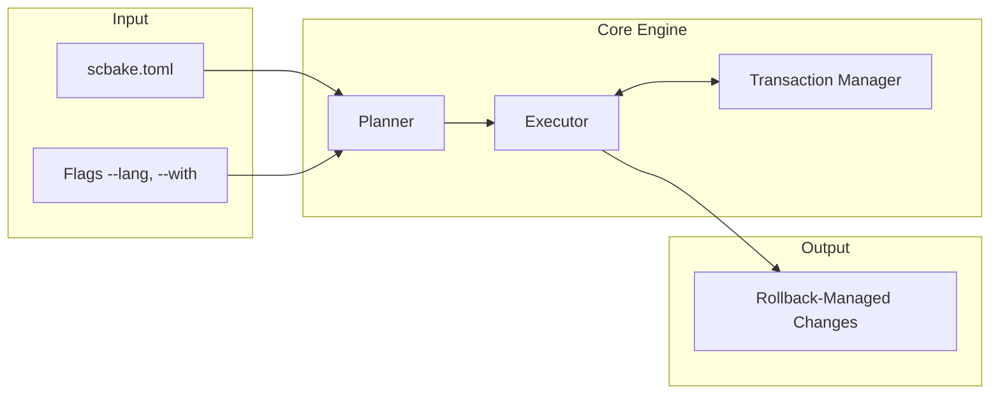

# Scaffold Bake: The Transactional Project Scaffolder

`scbake` is a single-binary CLI tool that simplifies project setup and maintenance by applying layered infrastructure templates and language packs with rollback on handled failures. It uses a **manifest file (`scbake.toml`)** as the source of truth for configuration, ensuring consistent configuration across projects. The scbake binary is self-contained; language packs may invoke the external toolchains listed below.


## Core Philosophy: Layering, Safety, and Extensibility

`scbake` provides a safe, composable, and customizable way to manage project infrastructure.



- **Layered Composition**
  Projects are built by applying independent **layers** (language packs and tooling templates). You can **mix and match** templates to achieve the desired setup.

- **Highly Configurable & Extensible**  
  Designed for flexibility. If a language pack is missing, simply **add it**. If a template doesn't fit, you can **modify or replace it**. The handler interface simplifies extension.

- **Built-in Rollback Safety**
  File and directory writes performed by scbake's file tasks are managed by a
  transaction manager: created paths are removed in reverse order, and files
  those tasks overwrite are restored from on-disk backups when a task or the
  manifest save fails. External tool commands are opaque, so handlers declare
  the paths a command may create or modify. Those paths are tracked before the
  command runs, whether or not they already exist: missing paths are removed on
  rollback, and existing regular files are backed up with their content and
  mode. Tracking an existing directory does not snapshot its contents. Zip
  extraction commands can also declare an archive whose entries are validated
  and tracked individually before extraction, including nested destinations and
  missing ancestors. Rollback covers project files, declared manifests, and
  declared zip entries, not build state. Pre-existing dependency trees such as
  `node_modules`, `.git` internals, non-zip extraction, and writes outside
  declared paths remain outside the transaction; custom handlers must declare
  their own paths. If a dependency install fails, delete the affected tree (for
  example `node_modules`) and reinstall from `package.json`/
  `package-lock.json`; the manifests are restored by rollback. SIGINT and
  SIGTERM cancel running tasks, stop the child process, run the same rollback
  as an in-process error, and exit 130/143. SIGKILL and
  other abrupt process termination bypass deferred cleanup, but the next run
  reports the interrupted transaction instead of treating it as clean;
  `scbake recover` rolls it back from the on-disk journal.

- **Prioritized Execution**  
  Tasks run in a defined order using **Priority Bands** (e.g., directory creation → language setup → universal config) to ensure dependencies are met.

- **Governance File Templates**
  Generates common governance files: a license, code owners, security policy,
  and community documents.

- **Custom Template Overrides (BYOT)**  
  Override any embedded `.tpl` file with your own version by passing `--template-dir` or setting the `SCBAKE_TEMPLATE_DIR` environment variable. Files in the override directory shadow the compiled-in defaults, enabling team-specific customizations without recompiling.

- **Private Template Registries**  
  Define named remote registries to host and distribute team templates. Use `scbake template registry add` to register a source, then `scbake template pull` to cache templates locally. The resolution chain checks **local overrides → registry cache → embedded defaults**, so you can layer customizations at every level.

- **Template Schema & Input Validation**  
  Every template can declare its expected inputs in a `schema.json` embedded alongside its templates. Before a single task executes, scbake validates the manifest metadata and `--set` flags against all selected templates' schemas, catching missing required variables early.

- **Explicit & Non-Interactive**  
  No hidden prompts. Output is deterministic for fixed inputs and a fixed clock,
  except where a task fetches external content: `npm create vite@latest`,
  `go mod tidy`, `start.spring.io`, and the `compliance` license text (SPDX,
  plus the current year) inherit upstream-version, network, and clock behavior.


## Installation

### Quick Install (macOS, Linux, and Windows via WSL/Git Bash)

Install from a **pinned release tag**. Unlike a branch URL, a release tag is
immutable, and the installer is attached to the release alongside its checksum.

`install.sh` is published as a release asset starting with the first release
that includes this installer change; older tags predate it and do not have the
asset (their `install.sh` URL 404s). Use the **latest** tag from
<https://github.com/Emin-ACIKGOZ/scbake/releases/latest>:

```bash
# Set TAG to a release that ships install.sh. Use the latest release tag
# (see https://github.com/Emin-ACIKGOZ/scbake/releases/latest) — older tags
# do not contain the installer asset.
TAG=<tag>
BASE="https://github.com/Emin-ACIKGOZ/scbake/releases/download/${TAG}"

# Download the installer and verify it against the release checksums
# (on macOS, use: shasum -a 256 -c -)
curl -fsSL -o install.sh "${BASE}/install.sh"
curl -fsSL -o SHA256SUMS "${BASE}/SHA256SUMS"
grep 'install.sh$' SHA256SUMS | sha256sum -c -

# Run the installer, pinned to the same tag
bash install.sh "${TAG}"
```

The installer detects your OS/architecture and installs that release's binary to
your PATH. It downloads the release's `SHA256SUMS` and verifies the binary
against it, aborting if the checksums file is missing or the hash does not match.

> **Do not** pipe a branch URL such as
> `https://raw.githubusercontent.com/Emin-ACIKGOZ/scbake/master/install.sh`
> into `bash`: `master` is mutable, so the script can change between review and
> execution. Download a pinned release (and verify it) instead.

**See [INSTALLING.md](docs/INSTALLING.md)** for detailed instructions, troubleshooting, and alternative installation methods:
- Go Install
- Manual download from GitHub Releases
- Build from source

### Build from Source

To compile the binary yourself, ensure you have **Go 1.26+** installed:

#### 1. Clone the repository:
```bash
git clone https://github.com/Emin-ACIKGOZ/scbake.git
cd scbake
```

#### 2. Build the project:
```bash
go build -o scbake main.go
```

#### 3. Move the binary to your path (optional):
```bash
mv scbake /usr/local/bin/
```

## Commands & Usage

### `new`: Create a New Project

Creates a new directory, bootstraps the `scbake.toml` manifest, and applies language packs and templates. 

**Note:** Git initialization can be added via the `--with git` template.

```bash
scbake new <project-name> [--lang <lang>] [--with <template...>] [--license <spdx>] [--copyright-holder <name>] [--template-dir <dir>] [--conflict-strategy <strategy>]
```

| Flag                 | Description                                      | Example                     |
| :------------------- | :----------------------------------------------- | :-------------------------- |
| `--lang`             | Primary language pack (`go`, `svelte`, `spring`) | `--lang go`                 |
| `--with`             | Comma-separated tooling templates                | `--with makefile,ci_github` |
| `--license`          | SPDX License ID (required for `compliance`)      | `--license MIT`             |
| `--copyright-holder` | Copyright holder name (required for `compliance`) | `--copyright-holder "Acme Corp"` |
| `--template-dir`     | Directory with custom template overrides         | `--template-dir ./my-tpls`  |
| `--set`              | Set template variable (`key=value`, can be repeated) | `--set service_id=srv-abc` |
| `--conflict-strategy`| How to resolve file drift: `fail`, `overwrite`, `artifact`, `keep-local` | `--conflict-strategy overwrite` |

**Example:**

```bash
scbake new my-backend --lang go --with makefile,ci_github
```


### `apply`: Apply Templates to an Existing Project

Applies new language packs or tooling templates to an existing path. Because `scbake` uses its own transaction logic, it does **not** require a clean Git tree to start; rollback and opaque-command caveats still apply. `apply`, `update`, and `drift --repair` require an existing project root and fail instead of creating a missing target directory; use `new` to bootstrap a new project.

```bash
scbake apply [--lang <lang>] [--with <template...>] [--template-dir <dir>] [--conflict-strategy <strategy>] [<path>]
```

| Argument | Description      | Default |
| :------- | :--------------- | :------ |
| `<path>` | Target directory | `.`     |

**Example:**

```bash
scbake apply --with maven_linter
```


### `update`: Update a Generated Project

Re-applies the managed template file writes recorded in `scbake.toml`, bringing a
generated project up to date **without clobbering local edits**. It does not
replay side-effecting commands or custom tasks such as license generation, file
appends, or XML insertions.

```bash
scbake update [--template-dir <dir>] [--conflict-strategy <strategy>] [<path>]
```

| Argument | Description      | Default |
| :------- | :--------------- | :------ |
| `<path>` | Target directory | `.`     |

Unlike `apply`, `update` reads *what was applied* from the manifest and runs no
side-effecting commands (no `go mod init`, `npm install`, …), so it is safe to
run repeatedly:

- **Idempotent.** With no template change and no drift, it makes no writes.
- **Three-way merge.** A pristine copy of each managed file is kept under
  `.scbake-base/`; when both the template and your file changed, `update` merges
  non-overlapping edits. Overlapping edits are written to a `<file>.scbake-new`
  artifact instead of being applied.
- **Policy.** `--conflict-strategy` accepts `merge` (default), `fail`,
  `overwrite`, `artifact`, and `keep-local`.

**Example:**

```bash
cd my-backend
scbake update
```

#### Committed merge base and migration

`.scbake-base/` is committed with the project, so a fresh clone has the common
ancestor that `update` needs. The root `.gitignore` keeps private state ignored
and re-includes the committed base:

```gitignore
.scbake/
!.scbake-base/
!.scbake-base/**
!.gitignore
```

Keep this block at the end of `.gitignore`: a later pattern such as `*`
overrides the re-includes and can hide the base. Scbake appends missing lines but
does not move an existing block, so check the order after editing `.gitignore`.

Run `git add .` from the manifest root, not a subdirectory, so new base files
are staged. Inside `.scbake-base`, a managed `.gitignore` or `.gitattributes` is
stored as `.gitignore.scbake-shadow` or `.gitattributes.scbake-shadow` so Git
does not apply those rules to the base tree itself. Those two suffixed names are
reserved.

The base stores pristine rendered bytes, so it can duplicate ignored build
outputs and any secret a template rendered. It also adds repository churn
whenever generated content changes; review the committed tree before publishing.

`managed_files` hashes are EOL-insensitive for NUL-free content: every run of CR
bytes immediately before LF is folded to one LF before hashing, so CRLF and LF
hash the same. This also means NUL-free binary content containing CRLF is
treated as text for hashing, and EOL-only edits are not drift. NUL-bearing
content is hashed byte-exact. A legacy file recorded while rendered as CRLF can
report one-time drift after upgrading. Base validation accepts a base whose
normalized or raw hash matches the ledger, but a legacy CRLF ledger hash does not
survive Git normalizing the migrated base to LF. Refresh the ledger with a clean
`scbake update` (or otherwise re-record the normalized hash) before committing
the migrated base, or keep the base byte-exact with `-text`.

**Breaking change.** This release no longer reads the old `.scbake/base/` path.
Migrate once by copying the base, renaming the two Git-special files, and
committing the result:

```sh
mkdir -p .scbake-base
cp -a .scbake/base/. .scbake-base/
find .scbake-base -type f -name .gitignore \
  -exec sh -c 'mv -n "$1" "$1.scbake-shadow"' _ {} \;
find .scbake-base -type f -name .gitattributes \
  -exec sh -c 'mv -n "$1" "$1.scbake-shadow"' _ {} \;
# Ensure the ignore block above is present at the end of .gitignore.
git rm -r --cached .scbake/base 2>/dev/null || true
git add .gitignore .scbake-base
git commit -m 'chore: migrate scbake merge base to .scbake-base'
rm -rf .scbake/base
```

If the legacy ledger holds raw CRLF hashes and Git normalizes the migrated base
to LF, those hashes no longer match: run a clean `scbake update` to refresh the
ledger before committing, or keep the base byte-exact with `-text`.

`git mv .scbake/base .scbake-base` alone is insufficient: the copied
`.gitignore` and `.gitattributes` would keep names Git applies to the base tree.
A missing or invalid base fails closed to a `.scbake-new` artifact, but sparse or
partial clones that omit `.scbake-base/` cannot merge. Native Windows/macOS
filters, LFS, and `working-tree-encoding` transformations remain unverified;
plain CRLF is handled by hash and merge-input normalization.

`drift` reports a base that is absent as `base-missing` (advisory by default)
and a base whose normalized or raw hash no longer matches the ledger as
`base-invalid` (blocking). Pass `--require-base` to make a missing base block,
for example in CI that requires a complete committed base. Detection is
read-only and lock-free and never backfills the base: a no-op `update` also does
not backfill. On a clean tree,
`scbake drift --repair --conflict-strategy overwrite` re-records the base as
part of rewriting the file; preserve local edits first, because that strategy
overwrites them and the default `merge` repair does not backfill.


### `drift`: Detect (and Repair) Changes to Managed Files

Reports whether the files scbake generated still match the hashes recorded in
`scbake.toml`, without writing anything. It exits non-zero when blocking drift
is found, so it can gate a CI pipeline.

```bash
scbake drift [--repair] [--require-base] [--conflict-strategy <strategy>] [<path>]
```

| Argument | Description      | Default |
| :------- | :--------------- | :------ |
| `<path>` | Target directory | `.`     |

- **Detection is read-only.** No templates are rendered, no transaction is
  opened, no lock is taken, and the network is never touched. Detection always
  scans every managed file recorded in the manifest, not just the `<path>`
  project.
- **Modified vs. missing.** Each managed file is reported as `modified` (its
  normalized hash changed) or `missing` (deleted), with its recorded and
  on-disk hashes. Hashes are EOL-insensitive for NUL-free content, so an
  EOL-only change is not drift.
- **Committed base.** For every current key, the pristine base under
  `.scbake-base/` is compared with the recorded hash. An absent base is
  `base-missing`; a base whose normalized or raw hash no longer matches is
  `base-invalid`, with the expected base path and both hashes. Keys resolved
  only through a legacy project path are skipped because no version wrote a
  base for a flat pre-scoping key. An unreadable base (other than "not found")
  is an error, not a finding.
- **Repair** (`--repair`) reuses the same reconciliation as `update`, so local
  edits are preserved according to `--conflict-strategy` (`merge` by default).
  Because `merge` preserves local edits, it does not clear drift; use
  `--conflict-strategy overwrite` to force generated content back. On a clean
  tree that also re-records a missing base; `merge` does not backfill.

Exit behavior:

| Finding | Default | `--require-base` |
| :------ | :------ | :--------------- |
| `modified`, `missing`, `base-invalid` | exit 1 | exit 1 |
| `base-missing` only | exit 0 (advisory) | exit 1 |

`--require-base` promotes missing bases to blocking results and cannot be
combined with `--repair`. A concurrent `update` can momentarily expose a
partially written base, so detection remains lock-free and may report a
transient `base-invalid` rather than taking the project lock.

**Example:**

```bash
# Fail a CI job if generated infrastructure was edited or deleted.
scbake drift

# Also fail when a committed merge base is missing.
scbake drift --require-base

# Force generated content back (discarding local edits).
scbake drift --repair --conflict-strategy overwrite

# Re-apply template changes, keeping non-overlapping local edits.
scbake drift --repair --conflict-strategy merge
```


### `recover`: Roll Back an Interrupted Transaction

A crash or `SIGKILL` can leave a transaction journal under
`.scbake/tmp/`. The next `apply`, `update`, `drift --repair`, or `drift` refuses
to treat that tree as clean. Roll the interrupted run back with:

```bash
scbake recover [--discard] [<path>]
```

| Argument    | Description                                      | Default |
| :---------- | :----------------------------------------------- | :------ |
| `<path>`    | Project directory inside the manifest root       | `.`     |
| `--discard` | Delete the transaction without restoring backups | `false` |

Recovery refuses to touch a transaction whose process is still running. Use
`--discard` only when the backups are known to be unusable; it deletes the
transaction directory without restoring files. An interrupted `new` is removed
as a whole after a successful recovery, matching the command's handled-error
cleanup.


### Concurrent Runs and Exit 75

Mutating commands (`new`, `apply`, `update`, `drift --repair`, `recover`, and
`recover --discard`) take a non-blocking exclusive advisory lock on
`<root>/.scbake/lock` before loading the manifest and hold it through commit or
rollback. The lock is scoped to the manifest root, so parallel subproject runs
under one root serialize on the same file. If another scbake process already
holds the lock, the command fails fast with exit **75** (`EX_TEMPFAIL`) and
makes no project changes; retry after the active run finishes. `new` is the
exception: it creates the project directory and an empty manifest before locking,
so a busy failure can leave that bootstrap residue for you to retry or remove.

Read-only commands (`drift`, `list`, and template registry/cache commands) and
every `--dry-run` run do not take the lock, so they remain usable while a writer
is active. `drift` and `apply --dry-run` still refuse a tree with an interrupted
transaction journal; `list` and template commands do not read project
transaction state.

The kernel releases the lock when the process exits, including a crash or
`SIGKILL`; a leftover `.scbake/lock` file is harmless because the lock is kernel
state, not file existence. Normal release removes the file and prunes an empty
`.scbake` directory. The manifest modification-time check is retained as a
fallback for non-scbake writers; the root lock is the primary scbake-vs-scbake
concurrency guard.

Rollback's content-hash check (delete a created file only if it still contains
what this transaction wrote) is deferred to follow-up work, so #133 remains
open.


### `template registry`: Manage Remote Registries

Define and manage remote template registries for sharing templates across teams.

```bash
scbake template registry add <name> <url> [--token <token>] [--version <version>] [--subdirectory <dir>]
scbake template registry remove <name>
scbake template registry list
```

| Command | Description |
| :------ | :---------- |
| `add <name> <url>` | Register a new template registry with optional auth token, default version, and archive subdirectory |
| `remove <name>` | Remove a registered registry |
| `list` | List all configured registries |

#### `template pull`: Cache Templates Locally

Downloads a template archive from a registry to the local cache (`~/.cache/scbake/templates/`), making it available as an override for `scbake new/apply`.

```bash
scbake template pull <name> [--registry <name>]
```

If `--registry` is omitted, all configured registries are tried in order.

### `list`: View Available Resources

Lists available or applied resources.

```bash
scbake list [langs|templates|projects]
```

### Monorepo Management

`scbake` is natively monorepo-aware. It walks up from the target path to find the nearest `scbake.toml` or `.git` folder, allowing you to manage a fleet of projects from a single central manifest.

Discovery is bounded by the nearest Git root: a manifest at or below that root wins, and a manifest above it is ignored. When the target tree has no `scbake.toml` and no `.git` bounds it (for example a directory under `/tmp` or a shared parent), a stray ancestor manifest is **not** adopted; discovery falls back to the target directory. This prevents a stray ancestor manifest in a shared parent from supplying project state, though it is not a security boundary against a principal that can also plant `.git` (see the caveat below).

- **Central Manifest**: Initialize your monorepo root with `scbake new <root-name> --with git` (or run `git init` in the root). This gives discovery an unambiguous repository boundary.
- **Add Projects**: Run `scbake apply <path> --lang <lang>` to add a new project in a subdirectory. `scbake` will find the root manifest and add the project to the central tracking list.
- **Scoped Templates**: Apply templates to specific sub-directories by passing the path: `scbake apply services/api --with go_linter`.
- **Fleet-wide Governance**: Run `scbake apply --with makefile` at the root to generate a unified build system that orchestrates all sub-projects.
- **Non-Git Monorepos**: If the central manifest lives in a tree without a Git root, pass `--allow-ancestor-search` to `apply`, `update`, `drift`, or `list` so an ancestor manifest can be adopted. The flag never crosses a `.git` root. It is not a security boundary: a principal that can write an ancestor directory can also plant a `.git` marker there.

**Note:** `--allow-ancestor-search` is an explicit opt-in for non-Git monorepos. Without it, applying to a marker-less subproject creates a nested manifest in that subproject instead of updating the central one. `update`, `drift`, and `list` also need the flag in a non-Git monorepo; without it, `drift` finds no local manifest and fails instead of evaluating the central one.


## Supported Language Packs

| Language   | Initialization Tasks                                                            | Required Binaries       |
| :--------- | :------------------------------------------------------------------------------ | :---------------------- |
| **Go**     | Creates `.gitignore`, `main.go`; runs `go mod init`, `go mod tidy`              | `go`                    |
| **Svelte** | Runs `npm create vite@latest`, installs dependencies, sets NPM scripts          | `npm`                   |
| **Spring** | Downloads starter zip from `start.spring.io`, extracts, makes `mvnw` executable | `curl`, `unzip` |

**Note:** Spring scaffolding only requires `curl` and `unzip`. Java is required later to build the generated project, not to create it.


## Tooling Templates

| Template        | Priority Band           | Features                                       |
| :-------------- | :---------------------- | :--------------------------------------------- |
| `community`     | Universal Config (1000) | Scaffolds `CONTRIBUTING.md`, `CODE_OF_CONDUCT.md`, `SUPPORT.md`, and `GOVERNANCE.md` |
| `editorconfig`  | Universal Config (1000) | Standard file formatting across the project                       |
| `ci_github`     | CI (1100)               | Conditional CI setup based on detected languages          |
| `compliance`    | Linter (1200)           | Adds `SECURITY.md`, `dependabot.yml`, `CODEOWNERS`, and dynamic `LICENSE` |
| `go_linter`     | Linter (1200)           | Standard `golangci-lint` configuration                     |
| `maven_linter`  | Linter (1200)           | Checkstyle config + automatic pom.xml plugin integration                       |
| `svelte_linter` | Linter (1200)           | ESLint 9 integration for Svelte projects          |
| `makefile`      | Build System (1400)     | Universal build/lint scripts for all projects  |
| `devcontainer`  | Dev Env (1500)          | Containerized DX with auto-detected toolchains |
| `git`  | Version Control (2000)          | Initializes repo, stages all files, and creates initial commit |

## Extending `scbake`

### Creating Custom Handlers

1. Create a new package under `pkg/lang` or `pkg/templates`.
2. Implement the `Handler` interface using task types.
3. Register the handler in the relevant `registry.go`.

### Available Task Types

- **CreateTemplateTask**: Creates new files from templates using a 3-tier resolution chain: **local overrides** (`--template-dir`) → **registry cache** (pulled templates) → **embedded defaults** (compiled-in)
- **AppendFileTask**: Appends content to existing files with idempotency checks
- **ExecCommandTask**: Executes shell commands with optional output tracking
- **CreateDirTask**: Creates directories with transaction tracking
- **InsertXMLTask**: Modifies existing XML files by inserting fragments at specified paths

### Example: Modifying Existing XML Files

For handlers that need to modify existing XML files (like Maven pom.xml), use `InsertXMLTask`:

```go
// Read snippet from embedded template
snippet, _ := templates.ReadFile("plugin_snippet.xml.tpl")

// Create insert task
task := &tasks.InsertXMLTask{
    FilePath:    "pom.xml",
    ElementPath: "/project/build/plugins",
    XMLContent:  string(snippet),
    Desc:        "Inject plugin into pom.xml",
    TaskPrio:    1201,
}

// The task automatically:
// - Validates XML structure
// - Prevents duplicate insertions (idempotent)
// - Integrates with transaction manager for rollback
// - Validates paths to prevent directory traversal
```


## Development Details

### Task Execution Priority

| Band Name             | Range     | Purpose               |
| :-------------------- | :-------- | :-------------------- |
| `PrioDirCreate`       | 50–99     | Directory creation    |
| `PrioLangSetup`       | 100–999   | Language setup        |
| `PrioConfigUniversal` | 1000–1099 | Universal config      |
| `PrioCI`              | 1100–1199 | CI workflows          |
| `PrioLinter`          | 1200–1399 | Linter setup          |
| `PrioBuildSystem`     | 1400–1499 | Build systems         |
| `PrioDevEnv`          | 1500-1999     | Dev environment setup |
| `PrioVersionControl`          | 2000-2100     | VCS initialization (Git) |

### Global Flags

| Flag                  | Description                                          |
| :-------------------- | :--------------------------------------------------- |
| `--dry-run`           | Show planned changes without applying them            |
| `--force`             | Override safety checks                               |
| `--template-dir`      | Directory with custom template overrides (env: `SCBAKE_TEMPLATE_DIR`) |
| `--allow-ancestor-search` | Allow ancestor `scbake.toml` discovery when no Git root bounds the tree |
| `--conflict-strategy` | How to resolve file drift: `fail`, `overwrite`, `artifact`, `keep-local` |
| `-v`, `--version`     | Show version                                          |
| `--set`              | Set template variable (`key=value`, can be repeated)  |

## Contributing

Contributions are welcome. See [CONTRIBUTING.md](CONTRIBUTING.md) for guidelines,
[docs/SCOPE.md](docs/SCOPE.md) for what belongs in core,
[docs/COMMIT_MESSAGES.md](docs/COMMIT_MESSAGES.md) for commit conventions,
[docs/CI_ARTIFACTS.md](docs/CI_ARTIFACTS.md) for verifying CI artifacts, and
[docs/TRIAGE.md](docs/TRIAGE.md) for how issues are handled.

## License

scbake is licensed under the Apache License 2.0. See [LICENSE](LICENSE) and
[NOTICE](NOTICE) for details.
