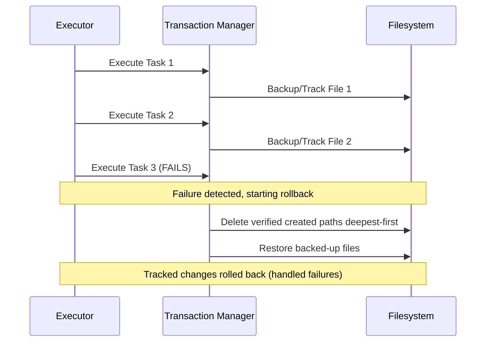

# scbake Architecture

This document explains scbake's design for contributors and maintainers.

## Overview

scbake is a **manifest-driven project scaffolder with rollback** built on three core concepts:

1. **Handlers** - Plugins (language packs, templates) that define what to create
2. **Tasks** - Discrete operations (create files, run commands) that handlers compose
3. **Transactions** - Rollback of created paths and backed-up files

```
User Command (scbake new)
    ↓
Handler Discovery & Registration
    ↓
Handler.GetTasks() → []Task
    ↓
Priority Sorting (execute in order)
    ↓
Task Execution (with transaction tracking)
    ↓
On success: Commit (delete backups)
On failure: Rollback (delete verified created paths deepest-first; restore backups)
```

---

## Core Components

### 1. Handler Interface

All language packs and templates implement this interface:

```go
// pkg/lang/registry.go
type Handler interface {
    GetTasks(targetPath string, templateDir string, registryCacheDir string, vars map[string]string) ([]types.Task, error)
}

// pkg/templates/registry.go
type Handler interface {
    GetTasks(targetPath string, templateDir string, registryCacheDir string) ([]types.Task, error)
}
```

Language handlers take one extra parameter, `vars map[string]string`, which
carries only the explicit `--set` values for the current invocation. Template
handlers keep the three-path form; they read inputs from `.Metadata` while
rendering.

The three path parameters support the **template resolution chain**:
1. `targetPath` — project root directory
2. `templateDir` — local override directory (`--template-dir` or `$SCBAKE_TEMPLATE_DIR`)
3. `registryCacheDir` — pulled template cache (`~/.cache/scbake/templates/`)

Tasks created at plan time use `registryCacheDir` and the configured registry allowlist later at execution time via `TaskContext` to resolve template files through the chain: **local overrides → configured registry cache → embedded defaults**.

Handlers that resolve templates while building the plan (before execution time)
may implement the optional `types.RegistryAwareHandler`
(`GetTasksWithRegistries(..., registries []string)`); core prefers it and passes
the configured allowlist. The base `Handler` interfaces are unchanged, and
handlers that only create `CreateTemplateTask` need not implement it.

**Responsibility**: Given a project path, return a list of tasks to execute.

**Examples**:
- `pkg/lang/go/go.go` - Go language handler
- `pkg/templates/makefile/makefile.go` - Makefile template

**Key insight**: Handlers inspect the target tree but do not modify it; they only produce tasks.

### 2. Task Interface

All operations (file creation, command execution, etc.) implement this interface:

```go
// internal/types/task.go (simplified)
type Task interface {
    Description() string
    Priority() int
    Execute(tc TaskContext) error
}
```

**Six built-in task types** (in `pkg/tasks/`):

| Type | Purpose | Example |
|------|---------|---------|
| **CreateTemplateTask** | Create files from Go templates | Create `Makefile` from template |
| **AppendFileTask** | Append to a file, creating it if absent (idempotent) | Append an entry to `.github/CODEOWNERS` |
| **ExecCommandTask** | Run shell commands | `go mod init` |
| **CreateDirTask** | Create directory structure | Create `src/` directory |
| **InsertXMLTask** | Insert XML into existing files | Add plugin to `pom.xml` |
| **ScaffoldTask** | Run a generator in an empty staging leaf, then move its output into the target | Scaffold a Vite + Svelte project |

**Key insight**: Tasks are **self-contained operations** with their own error handling; file tasks integrate with transaction tracking.

### 3. Transaction System

scbake's transaction system provides **rollback for handled failures**:



**Location**: `internal/filesystem/transaction/`

**Key features**:
- ✅ Tracks created files and directory changes
- ✅ Backs up modified files before overwrite
- ✅ Deepest-first, content-verified deletion of created paths; backups restored from the transaction directory
- ✅ Atomic rename for manifest updates
- ✅ Cleanup of orphaned backups
- ✅ Non-blocking per-root advisory lock (`.scbake/lock`) for mutating runs

Rollback is process-level and best-effort. SIGINT and SIGTERM are diverted into
the command context: the running child process is stopped, the normal rollback
path runs, and the process exits with 130 or 143. SIGKILL and other abrupt
process termination cannot run deferred cleanup, so every tracked mutation is
recorded in an fsynced `.scbake/tmp/tx-*/journal.jsonl` before it happens. The next `apply`, `update`,
or `drift` reports a dead owner's uncommitted journal instead of reporting the
tree clean, and `scbake recover` replays it to restore backups and remove
verified created paths. This protects against process crashes; it is not a
power-loss durability guarantee. External commands are tracked only when their
outputs are predicted.

Rollback covers declared project files and declared manifests, not tool-managed
build state. `Track` backs up an existing regular file but treats an existing
directory as a no-op, so a pre-existing dependency tree such as `node_modules`
is not snapshotted; a failed install can add, update, or prune packages. Treat
such trees as disposable and reinstall from the manifest and lockfile.

**Per-root locking**: Before loading the manifest, `new`, `apply`, `update`,
`accept`, `unmanage`, `drift --repair`, and `recover` acquire a non-blocking
exclusive advisory lock on `<root>/.scbake/lock` and hold it through commit or
rollback. The lock is
scoped to the manifest root, not a subproject, so parallel runs under one root
serialize. A second mutator fails fast with exit 75 (`EX_TEMPFAIL`) before any
project mutation; callers should retry after the active run finishes. `new` is
the exception: it creates the directory and empty manifest before taking the
lock, so a busy failure can leave that bootstrap residue. Existing-project
commands also fail rather than creating a missing root. Read-only commands and
all `--dry-run` runs do not acquire the lock. The kernel releases
the lock when the process exits or crashes, so a leftover lock file is harmless;
normal release removes the file and prunes an empty `.scbake` directory. The
manifest mtime check remains as a fallback for non-scbake writers. Rollback is
content-aware: a created regular file is deleted only when the raw SHA-256
recorded by the transaction still matches the current bytes. File-task writes
record the hash before writing; declared command outputs, archive destinations,
and the manifest are snapshotted after their write. A created directory is
removed deepest-first only when empty. Created regular files with no recorded
hash (for example legacy journals or interrupted writes) are kept with a
warning.

The first content snapshot of a created path is authoritative: later command
writes do not refresh it. If `go mod init` creates `go.mod` and a later command
in the same transaction (such as `go mod edit` or `go mod tidy`) modifies it
before a failure, rollback sees bytes that no longer match and keeps the file
with a warning. This is intentional: rollback will not delete bytes it cannot
prove the transaction wrote. A failed `apply --lang go` on a project without
`go.mod` can therefore leave a new, possibly unusable `go.mod`; `new` normally
avoids this because a failed `new` removes the whole project directory, though a
lock-busy failure leaves the bootstrap residue described above. Recover by
repairing the leftover directive and rerunning `apply`: set `GOTOOLCHAIN=local`
and use `go mod edit -go=<valid version>`, edit the `go` line in `go.mod` by
hand, or delete and recreate `go.mod`. `GOTOOLCHAIN=local` is needed because
under the default `GOTOOLCHAIN=auto`, a residue such as `go 1.999` makes even
`go mod edit` fail while it tries to download that toolchain. Plain
`go mod tidy` only works once the directive is satisfiable.

The check is forensic, not atomic: a writer can still replace bytes between
verification and unlink, and a background child can race the post-command
snapshot. Those races are accepted residuals.

---

## Execution Flow

### Loading & Discovery

```go
// cmd/apply.go → internal/core/run.go
func RunApply(rc RunContext, reporter types.Reporter) error {
    // 1. Discover project root & load manifest
    m, rootPath, err := manifest.Load(rc.TargetPath)

    // 2. Initialize transaction system
    tx, err := transaction.New(rootPath)

    // 3. Build execution plan
    plan, _, changes, err := buildPlan(rc)
}
```

**What happens**:
1. **Root Discovery**: `manifest.Load` walks up the directory tree from `TargetPath` until it finds an `scbake.toml` or a `.git` folder. Discovery is **bounded by the nearest Git root**: a manifest at or below that root is used, a manifest above it is ignored, and a manifest in the start directory is always accepted as local. When no `.git` bounds a marker-less tree, an ancestor manifest is adopted only with the `--allow-ancestor-search` opt-in (`manifest.LoadWithOptions`); otherwise discovery falls back to the start directory. This enables **Native Monorepo Support**, where a single root manifest manages projects in subdirectories, without silently trusting a stray manifest in a shared parent.
2. Initialize transaction system at the discovered `rootPath` to ensure cross-project rollback.
3. Build list of tasks to execute.

### Phase 2: Planning

```go
// internal/core/run.go
func buildPlan(rc RunContext) (*types.Plan, string, *manifestChanges, error) {
    // 1. Get language handler (if --lang specified)
    handler, err := lang.GetHandler(rc.LangFlag)
    langTasks, err := handler.GetTasks(rc.TargetPath, rc.TemplateDir, rc.RegistryCacheDir, rc.SetVars)
    plan.Tasks = append(plan.Tasks, langTasks...)
    
    // 2. Get template handlers (if --with specified)
    for _, tmpl := range rc.WithFlag {
        handler, err := templates.GetHandler(tmpl)
        tmplTasks, err := handler.GetTasks(rc.TargetPath, rc.TemplateDir, rc.RegistryCacheDir)
        plan.Tasks = append(plan.Tasks, tmplTasks...)
    }
    
    // 3. Sort by priority
    sort.Slice(plan.Tasks, func(i, j int) bool {
        return plan.Tasks[i].Priority() < plan.Tasks[j].Priority()
    })
}
```

**What happens**:
1. Call each handler's `GetTasks()` method
2. Collect all tasks into plan
3. Sort by priority (so directory creation happens before file creation)

### Phase 3: Execution

```go
// internal/core/executor.go
func Execute(plan *types.Plan, tc types.TaskContext, reporter types.Reporter) error {
    for _, task := range plan.Tasks {
        reporter.TaskStart(task.Description(), current, total)
        err := task.Execute(tc)
        if err != nil {
            return err  // ← triggers transaction rollback via defer
        }
        reporter.TaskEnd(err)
    }
}
```

**What happens**:
1. For each task (in priority order):
   - Show spinner (CLI feedback)
   - Execute task (with transaction tracking)
   - Show success/failure indicator
2. If any task fails:
   - Transaction `Rollback()` is called (via defer in `RunApply`)
   - Backups are restored from the transaction directory.

### Phase 4: Finalization

```go
// internal/core/run.go
func executeAndFinalize(...) error {
    // 1. Execute all tasks
    err := Execute(plan, tc, reporter)
    
    // 2. Update manifest
    updateManifest(m, changes)
    
    // 3. Save manifest (atomically)
    err := manifest.Save(m, rootPath)
    
    // 4. Commit transaction (delete backups)
    err := tx.Commit()
}
```

**What happens**:
1. All tasks completed successfully
2. Update in-memory manifest with applied projects/templates
3. Atomically write `scbake.toml` (write to temp file, rename)
4. Delete backup files (point of no return)

---

## Key Design Patterns

### 1. Priority Bands

Tasks execute in bands, ensuring correct ordering:

| Band | Range | Why | Examples |
|------|-------|-----|----------|
| PrioDirCreate | 50–99 | Directories must exist before file creation | `mkdir src/` |
| PrioLangSetup | 100–999 | Language initialization | `go mod init`, `npm init` |
| PrioConfigUniversal | 1000–1099 | Config files before linting | `.editorconfig` |
| PrioCI | 1100–1199 | CI setup after config | GitHub Actions |
| PrioLinter | 1200–1399 | Linters after framework setup | ESLint config |
| PrioBuildSystem | 1400–1499 | Build tools after all setup | Makefile |
| PrioDevEnv | 1500–1999 | Development setup last | Dev container |
| PrioVersionControl | 2000–2100 | Git must be last (commits everything) | Git init |

**Implementation**: `NewPrioritySequence(base, max)` gives you the next available priority in your band.

### 2. Manifest as Source of Truth

`scbake.toml` is the **single source of truth** for project state. Running
`scbake new demo --lang go --with editorconfig` writes:

```toml
scbake_version = "v0.3.0"

[[projects]]
  name = "demo"
  path = "."
  language = "go"

[[templates]]
  name = "editorconfig"
  path = "."

[metadata]
  go_version = "1.22"

[managed_files]
  ".editorconfig" = "9a59be2b2273da919904dc36048d240a38cfe1e4d528f6c5222fee868360b34d"
  ".gitignore" = "5f93f936a7096c41860b0c66ca27264cf6d2d2dc4dce71505963c76462bbbe03"
  "main.go" = "dbab7a356d8c97f9f4bb306186a30b801e2ea07cb7fd2d4e4aa3bcf6a94e706f"
```

| Key | Meaning |
|-----|---------|
| `scbake_version` | Manifest **schema** version, not the CLI release version. Written from `manifest.DefaultSbakeVersion` (`internal/manifest/io.go`). |
| `[[projects]]` | One table per applied language pack. `path` is relative to the manifest root (`"."` for the root project). |
| `[[templates]]` | One table per applied tooling template, recording its `name` and the `path` it was applied to. Like `[[projects]].path`, `path` is relative to the manifest root (`"."` for an apply at the root). |
| `[metadata]` | Inputs declared by template schemas (including defaults), values passed with `--set`, and `--license`/`--copyright-holder`. Omitted when empty. |
| `[managed_files]` | SHA-256 of every template-rendered file scbake manages, EOL-insensitive for NUL-free content, keyed by path relative to the manifest root. Drives `update` and `drift`. Omitted when empty. |
| `[accepted_files]` | Optional map of root-relative managed key to the SHA-256 of working-tree bytes the user accepted with `scbake accept`. Drift compares the working tree against this hash; `managed_files` and the committed base stay pristine. Omitted when empty. |
| `unmanaged_files` | Optional sorted, deduplicated list of root-relative paths detached with `scbake unmanage`. `update`/`drift --repair` filter their managed writers at plan time, and `apply` skips them unless `--force` re-manages the path. Omitted when empty. |

`[[projects]].path` and `[[templates]].path` name the same directory as the
matching `[managed_files]` key prefix: keys are root-relative, so a `"."` entry
(the root project) has no prefix, while `svc` yields keys such as `svc/main.go`.
Manifests written before keys were scoped may also contain flat,
project-relative keys. Older manifests may contain absolute paths: those that
resolve inside the discovered root are rebased against it in memory when the
manifest is loaded, and the next mutating command (`apply`, `update`,
`drift --repair`) persists the relative form. Absolute paths outside the root —
a moved or copied checkout, or a symlink alias of the root — are left unchanged
and must be fixed by hand: `apply` rejects absolute project paths as
non-relative, and `update`/`drift --repair` cannot rely on such entries. An
outside-root absolute **project** path fails the run with `project "svc" has an
invalid path …: path must be relative to the repository root` when a relative
template entry still matches the target, and reports no recorded templates when
nothing matches (for example, when both entries are outside the root). An
outside-root absolute **template** path on its own does not fail anything: a
relative project updates normally and that template entry is left unchanged,
though a later `apply` may add a relative template entry beside it.

Relative paths written by older builds are not rewritten, because the working
directory that authored them cannot be recovered. A recorded `./svc` never
matches: canonical paths are cleaned, so only the cleaned spelling can compare
equal. `repo/svc` matches only when it already is the target's canonical
root-relative path (for example, when the manifest root is the parent of
`repo`). It is inert when the manifest root is `repo` itself and the entry was
written from that root's parent: the target's canonical path there is `svc`, so
the entry names nothing. Project and template entries are matched independently,
so an inert entry only fails the run when it is the only entry naming the
target: `update`/`drift --repair` then report no templates and write nothing.
A valid `svc` entry beside an inert `./svc` still selects the target and
updates normally. A legacy `"."` is **not** inert: it is indistinguishable
from a genuine root project, so `update` or `drift --repair` run at the root
selects it and writes the recorded templates into the repository root —
creating root files such as `main.go`, `Makefile`, `.editorconfig`, and
`.github/workflows/main.yml`, overwriting existing files or leaving
`*.scbake-new` artifacts. Fix such an entry by hand, or re-apply at the
intended target and remove the stale entry. Leave `"."` unchanged when it
really is the root project.

The hashes above are real values from the current embedded templates; they change
whenever a rendered template changes. `[metadata]`, `[managed_files]`,
`[accepted_files]`, and `unmanaged_files` are omitted entirely when empty, so a
manifest for a run with no language pack has no `[[projects]]` or `[metadata]`
table. The accepted and unmanaged fields are additive and do not change
`scbake_version`; an older binary ignores them and may drop them on save. It
reports accepted edits as drift, recreates and re-records a missing detached
path, and writes an existing detached file to a `.scbake-new` artifact instead
of re-managing it.

**Why this matters**:
- ✅ Consistency: `scbake apply` re-reads manifest
- ✅ Idempotency: Applying same templates twice is safe
- ✅ Audit trail: Git history shows what was applied, when
- ✅ Team coordination: Everyone uses same manifest

### 3. Template Resolution Chain

Template files are resolved at execution time through a 3-tier fallback chain:

```
ReadTemplate(efs, tplPath, overrideDir, registryCacheDir, templateName, registries)
    │
    ├── 1. overrideDir (--template-dir or $SCBAKE_TEMPLATE_DIR)
    │      First check: local filesystem overrides
    │      Found → return immediately
    │      Permission error → propagate (no fallthrough)
    │      Not found → fall through
    │
    ├── 2. registryCacheDir (~/.cache/scbake/templates/)
    │      Second check: pulled template archives
    │      Searches only registries listed in registries.json, in the
    │      order they are configured; a cache order file is ignored, and
    │      an unconfigured cache directory is never read (nil/empty
    │      configured set disables this tier)
    │      Found → return immediately
    │      Not found → fall through
    │
    └── 3. efs (embedded filesystem in the Go binary)
           Final fallback: compiled-in defaults
           Found → return content
           Not found → error
```

**How the cache is populated:**
1. `scbake template registry add <name> <url>` — registers a remote source
2. `scbake template pull <name> --registry <name>` — downloads and caches the archive
3. Archives are extracted to `<cacheDir>/<registry>/<templateName>/<files...>`
4. On subsequent pulls, the cache is reused only when its manifest hash, version, and source URL match; a version or URL change (or a manifest without provenance) forces a re-download
5. Token auth supported via stored config or `SCBAKE_REGISTRY_TOKEN_<NAME>` env var

**Lifecycle and membership:**
- A cached tree is eligible only while its registry is configured. Deleting
  `registries.json` or removing (or renaming) a registry entry makes that cache
  inert rather than letting stale content shadow an embedded template; a
  malformed or unreadable config disables the registry tier. Changing only the
  URL, version, or token does not evict or invalidate existing cached content:
  it keeps resolving until `template pull` refreshes it or `remove` deletes it.
- `scbake template registry remove <name>` renames `<cacheDir>/<registry>` to a
  sibling `.evict-<key>-<random>` staging path inside the cache root, saves the
  config change, then deletes the staging path. The key is an implementation
  detail derived from the registry name, URL, version, and subdirectory (the
  token is excluded so a token rotation does not invalidate recovery); it makes
  the staged tree attributable to exactly one configured registry.
  - If staging fails, nothing is changed. If saving fails, the in-memory config
    and the staged cache path are restored and the save error is returned. If
    that restore also fails, a combined error is returned and the attributable
    residue is repaired by the next sweep.
  - Once the save succeeds the removal is durable: if only the final cleanup
    fails, `remove` prints a warning to stderr, still reports success, and exits
    zero. The next sweep retries the cleanup.
  - Every `add` and `remove` (and the internal `Manager.SetToken` API) starts by
    sweeping the cache root,
    before it mutates anything. A staged root is restored only when its key still
    matches a configured, validly named registry and that registry's live path is
    absent; every other keyed root is deleted. Roots younger than 60 seconds,
    live registries whose names begin with `.evict-`, and unparseable legacy
    `.evict-<digits>` roots are never touched.
  - The rename stays on one filesystem (one volume on Windows). Other registries
    and the cache root are untouched. A symlink at the registry path is renamed
    as a link and never followed, and the sweep uses `Lstat` plus lexical
    containment only.
- `--dry-run` appends the resolved tier to each template-rendered
  (`CreateTemplateTask`) file: `[template-dir]`, `[registry: <name>]`, or
  `[built-in]`. Normal runs and their output are unchanged. The label is resolved
  at dry-run time with the same resolver, and the `maven_linter` snippet injected
  into `pom.xml` is not disclosed.

### 4. Optimistic Locking (Fallback)

scbake still detects concurrent manifest modifications via the file state
recorded at load time, as a fallback for non-scbake writers and older scbake
versions:

```go
// internal/manifest/io.go
type manifestFingerprint struct {
    modTime time.Time
    absent  bool // true when no manifest existed at Load
}

var manifestStates = make(map[string]manifestFingerprint)

func Load(...) {
    // Existing manifest: record its mtime.
    manifestStates[manifestPath] = manifestFingerprint{modTime: info.ModTime()}
    // Absent manifest: record the absence so a later creation is a conflict.
    manifestStates[manifestPath] = manifestFingerprint{absent: true}
}

func Save(...) {
    // Before saving, reject a file that changed since Load.
    state := manifestStates[manifestPath]
    current, err := os.Stat(manifestPath)
    if err == nil && (state.absent || !current.ModTime().Equal(state.modTime)) {
        return errors.New("manifest conflict: file was modified by another process")
    }

    // ...write and sync the temp file, capture its mtime before rename, then:
    // rename(tempPath, manifestPath)
    manifestStates[manifestPath] = manifestFingerprint{modTime: tempModTime}
}
```

The absent-at-load sentinel catches an external create between `Load` and
`Save`. After a successful rename, the fingerprint is refreshed from the mtime
captured on the fully written temp file, so a second in-process `Save` does not
falsely conflict and a concurrent writer's final-path mtime is never adopted.

**Why**: This check runs after task execution and catches TOCTOU
(Time-Of-Check-Time-Of-Use) changes from external editors or writers. It is no
longer the primary scbake-vs-scbake guard; the per-root lock serializes mutating
scbake processes before the manifest is loaded.

### 5. Updating Generated Projects

`scbake update` replays the selection recorded in the manifest instead of CLI
flags. Two properties make it safe:

- **Provenance.** `[[templates]]` records the real `{name, path}` of every
  tooling template, and `[[projects]]` records each project's `language`, so
  `update` can reconstruct exactly what `apply` ran (D2).
- **Pristine committed base.** Every managed write stores its rendered bytes
  under `.scbake-base/<path>`. When both the template and the working file
  changed, `update` runs a conservative line-oriented three-way merge
  (`internal/merge`) against that base. Non-overlapping edits merge; overlaps
  fall back to an artifact. Only tasks that declare themselves managed file
  writers (`CreateTemplateTask`, `LicenseTask`) are replayed, so environment
  commands and untracked writers such as `AppendFileTask` and `InsertXMLTask`
  never re-run. Replaying `LicenseTask` loads the license text from the embedded
  SPDX snapshot only when LICENSE is missing or modified; a clean LICENSE is
  skipped and its base is backfilled from the recorded bytes. An unknown license
  ID is a closed failure, leaving managed files untouched.

The base lives at the project root rather than under the ignored `.scbake/`
directory so a normal commit carries it to a clone. The root `.gitignore` must
contain:

```gitignore
.scbake/
!.scbake-base/
!.scbake-base/**
!.gitignore
```

The directory and glob re-includes are both required under broad patterns such
as `.*` or `*.out`; `!.gitignore` keeps the rules file itself stageable. The
block must remain last: a later pattern such as `*` overrides the re-includes.
Scbake appends missing lines but does not move an existing block, so a reordered
file is only repaired by restoring the block order. The base must be staged from
the manifest root (`git add .`), because a subdirectory add cannot reach a
root-level directory. Inside `.scbake-base`,
managed `.gitignore` and `.gitattributes` files are renamed to
`.gitignore.scbake-shadow` and `.gitattributes.scbake-shadow` at every depth;
otherwise Git would apply those copies to the base tree and hide or transform
sibling payloads. Those suffixes are reserved names.

`managed_files` records the hash of the pristine render. For NUL-free content,
every run of CR bytes immediately before LF is folded to a single LF before
hashing, so CRLF and LF hash identically and EOL-only edits are not drift. This
also means NUL-free binary content containing CRLF is treated as text. NUL-bearing
content is hashed byte-exact. The base tree itself keeps the render byte-exact;
normalization applies only to hashing and to merge inputs. A legacy
CRLF-recorded file can show one-time drift. Base validation accepts a base whose
normalized or raw hash matches the ledger, but a legacy CRLF ledger hash does not
survive Git normalizing the migrated base to LF. Refresh the ledger with a clean
`scbake update` (or otherwise re-record the normalized hash) before committing
the migrated base, or keep the base byte-exact with `-text`. A merged file is
still recognized as locally modified on the next `apply` (SCB-056).

The move from `.scbake/base/` to `.scbake-base/` is a breaking change with no
read fallback. Migration is manual: copy the old base, rename the two
Git-special files, ensure the ignore block above, stage `.gitignore` and
`.scbake-base`, and remove the old tracked or ignored directory. If the legacy
ledger holds raw CRLF hashes and Git normalized the migrated base to LF, run a
clean `scbake update` to refresh the ledger before committing, or keep the base
byte-exact with `-text`. A plain
`git mv .scbake/base .scbake-base` is insufficient because the shadow names
remain active. A missing or invalid base falls back to an artifact rather than a
silent merge. Committing rendered bytes can expose ignored outputs or secrets
and adds churn. Sparse/partial clones may omit the base, and native
Windows/macOS checkout filters, LFS, and `working-tree-encoding` remain
unverified; hash and merge-input normalization cover plain CRLF only.

### 6. Drift Detection

`scbake drift` is the read-only projection of the same `managed_files` ledger
that `update` writes. For every recorded key it hashes the working-tree file with
the EOL-insensitive contract and classifies it `modified` (normalized hash
differs), `missing` (absent), or clean. EOL-only changes to NUL-free content are
therefore not drift.

If a key has an `[accepted_files]` entry, the working-tree comparison uses that
accepted hash (`scbake accept`) and the finding is printed with `accepted`
instead of `recorded`. The pristine `[managed_files]` hash is still what the
committed base is validated against, so accepting an edit cannot hide a
`base-invalid` result. Detached paths (`unmanaged_files`) are not in
`managed_files`, so drift ignores them entirely.

For every current, non-legacy-resolved key it also reads the committed base under
`.scbake-base` with the shared shadow-path mapping and compares it to the ledger
with the same predicate `update` uses. An absent base is `base-missing`; a hash
mismatch is `base-invalid`, blocking on exit. Missing bases are advisory by
default and become blocking under `--require-base`, which cannot be combined with
`--repair`. A base read error other than `ENOENT` (for example a permission
error, directory, or symlink rejected by the containment check) is returned as
an error so detection fails closed instead of misreporting an I/O problem as
drift. Flat pre-scoping keys resolved through a project path are skipped because
no version wrote a base for them. Findings are sorted by `(path, kind)` so two
findings on one path are deterministic.

It opens no transaction, takes no project lock, renders no template, and never
touches the network, so it is safe as a CI gate; it exits non-zero when any
blocking finding remains. `--repair` delegates to `core.RunUpdate`, so detection
and repair share one reconciliation implementation (`internal/drift`). Detection
does not backfill a missing base; a no-op `update` does not either.

`update` and `drift --repair` derive their plan from `[[projects]]`/`[[templates]]`,
then filter managed writers whose root-relative output path is listed in
`unmanaged_files` before execution, so `--dry-run` does not list a task the real
run skips. `apply` performs the same filter unless the global `--force` flag is
set; a forced canonical write re-manages the path and clears its unmanaged entry.

Detection is deliberately conservative: a locally edited file is drift even
when `update`'s default `merge` strategy is a no-op that preserves the edit.
A `merge`-style repair therefore leaves the file reported as drift (use
`overwrite` to force restoration), which is why `drift` after `--repair` may
still exit non-zero by design. Staying lock-free means a concurrent `update` can
momentarily expose a partially written base, which detection may report as a
transient `base-invalid` rather than waiting for or acquiring the lock.

---

## File Structure

```
scbake/
├── main.go                          # Entry point
├── cmd/                             # CLI commands
│   ├── root.go                      # Base command
│   ├── new.go                       # 'scbake new' command
│   ├── apply.go                     # 'scbake apply' command
│   └── list.go                      # 'scbake list' command
├── internal/
│   ├── core/                        # Core execution engine
│   │   ├── run.go                   # Main orchestration
│   │   └── executor.go              # Task execution loop
│   ├── filesystem/
│   │   └── transaction/             # rollback system
│   ├── manifest/                    # Manifest I/O & conflict detection
│   ├── templateregistry/            # Private registry system
│   │   ├── config.go                # Registry CRUD, JSON persistence
│   │   ├── pull.go                  # HTTP download, tar.gz extraction
│   │   ├── resolver.go              # Cache path resolution
│   │   ├── config_test.go           # Unit tests
│   │   ├── pull_test.go             # Unit tests
│   │   └── resolver_test.go         # Unit tests
│   ├── ui/                          # CLI output (spinners, messages)
│   ├── types/                       # Core data structures
│   │   ├── plan.go                  # Handler, Task interfaces
│   │   ├── manifest.go              # Manifest structure
│   │   └── priority.go              # Priority band system
│   └── util/                        # Utilities (file ops, validation)
├── pkg/
│   ├── lang/                        # Language handlers
│   │   ├── go/
│   │   ├── spring/
│   │   └── svelte/
│   ├── templates/                   # Template handlers
│   │   ├── makefile/
│   │   ├── git/
│   │   ├── ci_github/
│   │   ├── linters/
│   │   └── ...
│   └── tasks/                       # Built-in task types
│       ├── create_template.go       # CreateTemplateTask
│       ├── append_file.go           # AppendFileTask
│       ├── exec_command.go          # ExecCommandTask
│       ├── create_directory.go      # CreateDirTask
│       ├── insert_xml.go            # InsertXMLTask
│       └── scaffold.go              # ScaffoldTask
└── docs/                            # Documentation
    ├── EXTENDING.md                 # Extension guide
    └── ARCHITECTURE.md              # This file
```

---

## Adding a New Language Pack

To add a new language (e.g., Rust):

### 1. Create Package

```bash
mkdir -p pkg/lang/rust
touch pkg/lang/rust/rust.go
```

### 2. Implement Handler

```go
package rust

import (
    "scbake/internal/types"
    "scbake/pkg/tasks"
)

type Handler struct{}

func (h *Handler) GetTasks(_ string, _ string, _ string, _ map[string]string) ([]types.Task, error) {
    // Create priority sequence
    seq, _ := types.NewPrioritySequence(types.PrioLangSetup, types.MaxLangSetup)
    var plan []types.Task
    
    // Add tasks
    p, _ := seq.Next()
    plan = append(plan, &tasks.ExecCommandTask{
        Cmd: "cargo",
        Args: []string{"init"},
        TaskPrio: int(p),
        RunInTarget: true,
        Desc: "Initialize Cargo project",
    })
    
    return plan, nil
}
```

### 3. Register Handler

In `pkg/lang/registry.go`:

```go
import "scbake/pkg/lang/rust"

func init() {
    Register("rust", &rust.Handler{})
}
```

### 4. Test

```bash
go build -o scbake main.go
./scbake new test-proj --lang rust
```

See `docs/EXTENDING.md` for a complete guide.

---

## Adding a New Template

Similar to languages, but use `pkg/templates/` and `PrioLinter`, `PrioBuildSystem`, etc.

Example: Add a Python linter template

```bash
mkdir -p pkg/templates/python_linter
```

Implement handler and register in `pkg/templates/registry.go`.

---

## Testing Guide

### Unit Tests

```bash
go test ./internal/types
go test ./pkg/lang/go
go test ./pkg/templates/makefile
```

### Integration Tests

```bash
go test ./tests  # Full end-to-end workflows
```

### Race Detection

```bash
go test ./... -race  # Check for race conditions
```

### Benchmarks

```bash
go test ./pkg/tasks -bench=.
```

### Code Quality

```bash
go fmt ./...           # Format code
golangci-lint run ./...# Lint
go vet ./...          # Vet checks
```

---

## Performance Considerations

### Handler Discovery (O(1))
- Handlers stored in map, lookup is constant time
- No filesystem scanning needed

### Task Execution (O(n))
- Tasks execute in sequence (single-threaded)
- No parallelization (rollback requires ordering)

### Transaction System (O(n))
- Rollback is linear in number of created files
- Backups are stored efficiently (copy on write could optimize future)

### Memory Usage
- ~500KB for 50 handlers
- Depends on task plan size (typically <100 tasks per project)

---

## Security Model

### What scbake does
✅ Validates paths to prevent directory traversal
✅ Bounds ancestor manifest discovery to the nearest Git root; marker-less ancestors require `--allow-ancestor-search`
✅ Uses transaction tracking and rollback to recover from handled failures
✅ Detects concurrent modification attempts
✅ Backs up files before overwrite
✅ Validates XML structure before insertion

### What scbake doesn't do
❌ Sandbox handlers (they run with user's permissions)
❌ Protect against a principal that can plant both `scbake.toml` and `.git` in an ancestor directory
❌ Verify signatures (no plugin system yet)
❌ Audit all commands (could add logging in v0.2.0)
❌ Prevent fork bombs (subprocess resource limits not enforced)

**Trust model**: Handlers are trusted code. They run with user's UID.

---

## Future Improvements

### v0.1.0 (Planned)
- Config-driven extension discovery
- Built-in handler refactoring (unified system)
- Better error messages

### v0.2.0+ (Possible)
- Subprocess-based plugins (if demand exists)
- Audit logging
- Plugin registry/marketplace
- Monorepo support

---

## Contributing

1. Read this document
2. Read `CONTRIBUTING.md`
3. Follow code style: `go fmt`, `golangci-lint`
4. Add tests for new code
5. Ensure all tests pass: `go test ./...`
6. Create PR with clear description

---

## Questions?

- **How do I add a template?** See `docs/EXTENDING.md`
- **How do transactions work?** See `internal/filesystem/transaction/`
- **How is manifest versioning handled?** See `internal/manifest/io.go`
- **How are priorities resolved?** See `internal/types/priority.go`
